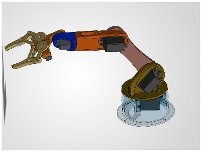
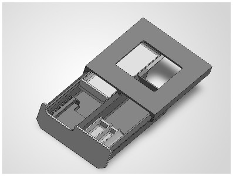
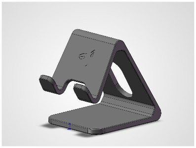
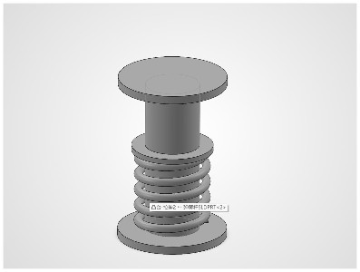

# 宋乐辰的机械设计作品集

中国计量大学 · 机械设计制造及其自动化本科在读。以下为使用 SolidWorks 独立完成的建模练习，展示零件建模、装配约束与结构布局能力。

## 机械臂装配体设计

- 完成时间：利用课余时间，3 天内完成。
- 工作内容：完成底座、连杆、关节及末端夹爪 4 类核心部件的建模与装配。
- 成果：通过多零件配合与结构布局检查，形成完整机械臂装配体。

## 抽屉装配体设计

- 完成时间：利用课余时间，3 天内完成。
- 工作内容：完成抽屉主体、导轨、面板及内部结构的建模与装配。
- 成果：形成含 2 组抽屉和 1 个顶部收纳位的装配体，并完成零件配合检查。

## 手机支架设计

- 工作内容：采用一体式支撑结构，设计承托槽与背部镂空。
- 成果：综合运用拉伸、切除、圆角和倒角 4 类特征，完成支架零件模型。

## 弹簧装配体设计

- 工作内容：完成弹簧、中心杆及两端支撑 3 类零件的建模与装配。
- 成果：运用旋转、螺旋扫描等特征生成弹簧组件，并完成基础装配检查。

以上图片为建模截图；当前展示内容为模型设计练习，不涉及实物制造或实测性能结论。
